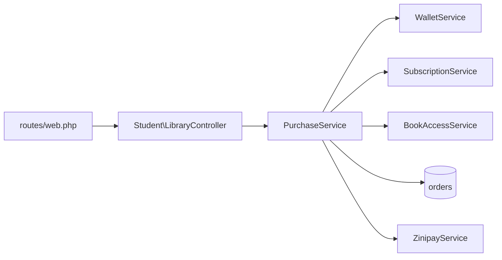

# Codebase Graph & Analysis

Goal: turn a 350-file Laravel + Inertia/Vue app into a small, accurate graph you can reason about — then answer questions from the graph, not from guesses.

## 1. Build the layers first

This project has four hard layers. Always resolve a symbol through them in order:

```
route (routes/*.php)
  -> controller (app/Http/Controllers/{Admin,Student,Api,Public})
    -> form request (app/Http/Requests/**)  [validation]
    -> service (app/Services/**)            [business logic]
      -> model (app/Models/**)              [persistence]
        -> migration (database/migrations/**)
  -> Inertia page (resources/js/Pages/**)
```

Rules of thumb:
- Controllers should stay thin. If a controller has business rules, the real graph node is the service.
- `app/Services` is the core: `PurchaseService`, `WalletService`, `SubscriptionService`, `BookAccessService`, `ReferralService`, `AccessGrantService`.
- AI providers live in `app/Services/Ai/**` behind `AiProviderFactory` + `AiProviderContract`.
- Payment gateways implement `App\Contracts\PaymentGatewayContract`; `ZinipayService` is the only real implementation.

## 2. Cheap, repeatable extraction commands

Run these instead of reading whole directories:

```powershell
# Route inventory by area
php artisan route:list --json | ConvertFrom-Json |
  Select-Object method, uri, name, action | Format-Table -AutoSize

# Who uses a class?
rg -n "PurchaseService" app resources routes

# Model -> table -> columns
rg -n "Schema::create\('orders'" database/migrations -A 25

# Vue page -> controller that renders it
rg -n "Inertia::render\('Student/Library/Index'" app
```

Prefer `rg` (ripgrep). Do not dump entire files when a symbol search answers the question.

## 3. Emit a Mermaid graph

When a diagram helps, produce Mermaid and keep it small (10–20 nodes max). Example shape:



Rules:
- One diagram per question. Never one giant diagram of the whole app.
- Label edges with the actual method when it matters (`purchaseBook()`), not just "uses".
- Mark external systems separately (ZiniPay, Firebase, AI providers, Meilisearch, Reverb).

## 4. Analysis checklist

When asked to "analyze" the project, check these every time:

1. **Reachability** — every route resolves to an existing controller method and an existing Inertia page component. Missing components render a blank screen, not a 404.
2. **Query shape** — list endpoints must eager-load (`with`, `withCount`). Flag any `->get()` inside a `@foreach`/`map` that touches a relation.
3. **Write safety** — money and access changes must sit inside `DB::transaction` and go through a service, never a controller.
4. **Auth surface** — three guards: `web`, `admin`, `api` (Sanctum). Check each new route is inside the right middleware group.
5. **Async work** — anything slow (AI, PDF parsing, video, mail) must be a queued job, not inline.
6. **Test reachability** — `php artisan test` must run on the sqlite test DB declared in `phpunit.xml`. MySQL-only SQL (`MODIFY`, `CHANGE`) breaks it.
7. **Config drift** — `.env.example` must match every `env()` call in `config/`.

## 5. Reporting findings

Output findings as a table with: `severity`, `file:line`, `what`, `why it matters`, `fix`. Severity is `blocker | high | medium | low`. Never report a finding you have not verified by reading the code or running the app.

## 6. Guardrails

- Treat the code graph as evidence, not truth: re-check with a grep before asserting "nothing else uses this".
- Do not delete "unused" code that is referenced from Blade, config, routes, or string-based container bindings.
- Generated assets in `public/build` are committed on purpose — don't analyze them as source.
